# What we know about sp8dgg

This report covers **sp8dgg only**, with experiment-level observations and the final selection of 500 sequences. All activity values below are model predictions; the plots do not establish experimental expression or specificity.

The main observation is a trade-off: experiments with fewer mutations produce higher-scoring sequences, but their final populations are much closer to their best sequence. Selecting candidates across experiments with an explicit distance constraint gives a more diverse final set.

## How to read the plots

Each figure focuses on one result. Axes, points, and colour scales are preserved, and the headings identify the experimental settings.

Throughout this report, the **comparison score** is:

$$S = \min(\mathrm{on\text{-}target}) - \max(\mathrm{off\text{-}target}).$$

All experiments are compared using this same score. It is equal to the optimization fitness for 20 mutations (baseline), but should not be confused with the stored fitness in experiments using a different objective, such as an off-target power penalty. “Top” in the plots means the candidate with the highest comparison score.

Hamming distance counts differing positions between equal-length sequences. The sp8dgg sequences here are **239 bases** long. Normalized Hamming similarity is `1 − distance / 239`: higher values mean greater similarity to the top sequence. Distance-to-top is one measure of diversity; it is not the distribution of all pairwise distances.

## Configuring the experiments

The settings below are taken from the experiment configurations. Merge these sections into a working configuration with the appropriate model, genome, plasmid, and condition resources. They describe the experimental setup; they do not guarantee the exact numerical outcomes shown here. The runs were configured for up to 2,000 generations, and the plots represent their saved endpoints, which may occur earlier.

### Common baseline settings

The baseline uses 239-base insertions, 20 mutations per child, crossover probability 0.6, and selection by the difference between the weakest on-target and strongest off-target prediction. Scoring averages the predicted track over a 501-base window centred on the reporter TSS.

```yaml
sampler:
  seq_len: 239
  tss_sampling_window: 1000
  seed: 42
  unique_sequences: true
  max_attempts: 100000

scorer:
  type: track_window
  params:
    center: reporter_tss
    width_bp: 501
    aggregate: mean

fitness:
  type: min_on_max_off
  params:
    on_power: 1.0
    off_power: 1.0
    off_weight: 1.0

offspring:
  type: parallel
  params:
    parent_selection: shifted_fitness
    crossover_probability: 0.6
    mutations_per_child: 20
    random_seed: 42
    max_workers: 5
    batches_per_worker: 2

optimization:
  initial_population_size: 30000
  population_size: 8000
  offspring_size: 8000
  n_generations: 2000
  selection_strategy: top_k
  elite_count: 1
  tournament_size: 10
  offspring_generator_mode: records
  random_seed: 42
```

Use the sp8dgg plasmid with `CRE` as the replacement feature, `MinPromotr` as the reporter feature, and the full circular plasmid as scoring context (`plasmid.window_size: full`, `plasmid.circular: true`). The on-target condition keys are `SRX13711120` and `SRX34494533`; the off-target keys are `SRX21227773`, `SRX26538054`, and `SRX34493586`. Keep the model checkpoint, tokenizers, sequence context, plasmid, and target conditions fixed when comparing settings.

### Changes for each experimental question

Change the following values in the baseline configuration, retaining the other settings:

| Goal | Configuration change | Observation in these runs |
|---|---|---|
| Favour high comparison scores with small mutation steps | Set `offspring.params.mutations_per_child` to `5` or `10` | Higher scores, smaller median distance to the top sequence |
| Explore larger mutation steps | Set `offspring.params.mutations_per_child` to `40` | Larger median distance, lower endpoint score |
| Increase predicted relative on/off-target separation | Set `fitness.params.off_power` to `1.2`; keep `on_power: 1.0` and `off_weight: 1.0` | Approximately sixfold separation for the top comparison-score candidate |
| Apply a stronger off-target penalty | Set `fitness.params.off_power` to `1.4`, `1.6`, or `1.8` | Lower off-target predictions accompanied by lower on-target predictions |
| Change retained population size | Set `optimization.population_size` to `1000`, `2000`, `4000`, or `14000` | Changes the pool available for final diverse selection |
| Change crossover probability | Set `offspring.params.crossover_probability` to `0.0`, `0.3`, or `0.9` | Tests crossover while keeping 20 mutations per child |

In the population-size experiments, `optimization.offspring_size` remains **8000** and `initial_population_size` remains **30000**. Changing the retained population size therefore does not also change the number of offspring generated per generation.

The final 500-sequence selection is a separate postprocessing step: request **500 candidates**, require minimum pairwise Hamming distance **100**, exclude both BsaI motifs, and rank by the common comparison score. These selection settings do not change the generation fitness or mutation settings.

## 1. Selection produces a sharp score boundary

In the 20 mutations (baseline) experiment, most retained candidates lie near the lower end of the score distribution, with a smaller tail of high-scoring sequences. This is consistent with selection and offspring generation concentrating the surviving population in a restricted score range.

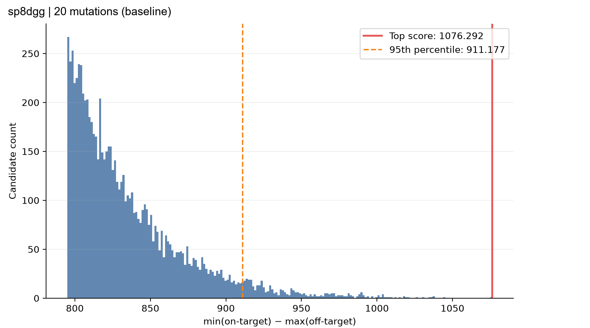

In the on-target/off-target plot, equal-score candidates lie on a straight line:

$$\min(\mathrm{on\text{-}target}) = \max(\mathrm{off\text{-}target}) + S.$$

A score cutoff therefore produces a diagonal boundary. Under truncation selection, candidates below the current cutoff are removed; the boundary can move as the population improves. This final-population plot shows the boundary at the saved endpoint, rather than its movement over time. Colour shows similarity to the top sequence, with lower values indicating greater distance from it.

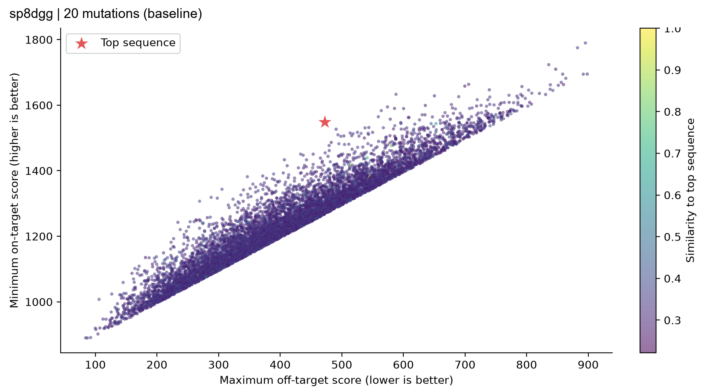

## 2. Late-born sequences contribute high scores

The baseline plot groups **members of the final population** by the generation in which they first appeared. Several high-scoring candidates were born late in the run, and the best comparison-score candidate was born at generation 968.

This supports continued discovery of good candidates during the run. It does not show the complete best-so-far trajectory: candidates that disappeared before the final snapshot are absent, and the plotted “Best in generation” is the best surviving candidate born in that generation.

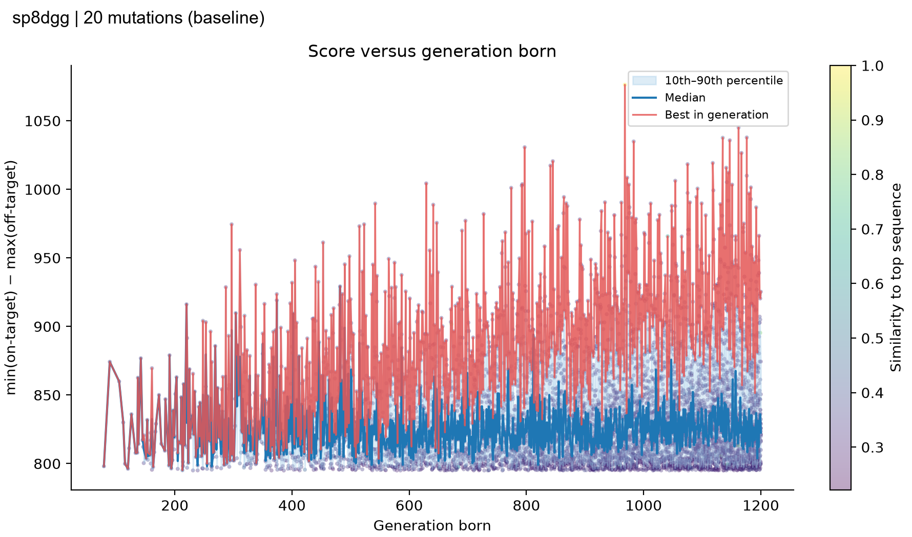

## 3. Fewer mutations give higher scores and lower diversity around the top sequence

The mutation experiments show a clear association between higher comparison scores and smaller distances to the best sequence:

| Experiment | Highest comparison score | Median distance to its top sequence |
|---|---:|---:|
| 5 mutations | 1,978.08 | 61 bases |
| 10 mutations | 1,672.52 | 99 bases |
| 20 mutations (baseline) | 1,076.29 | 161 bases |
| 40 mutations | 735.79 | 175 bases |

The score-versus-similarity plots illustrate the contrast between the baseline and the 5-mutation experiment. Each plot uses its own experiment's top sequence as the reference.

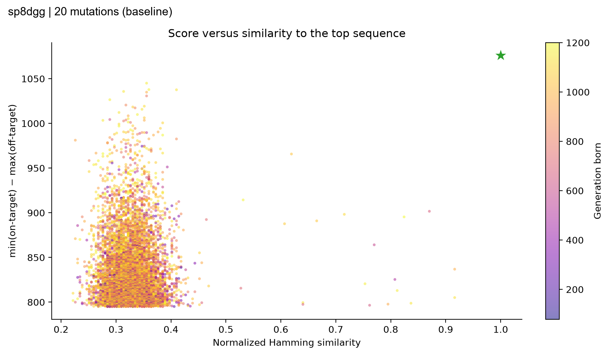

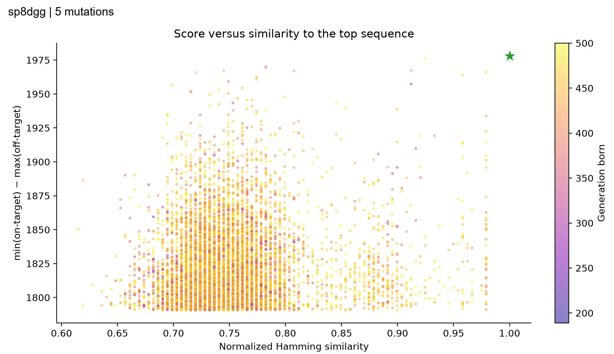

The distance distributions make the difference more explicit:

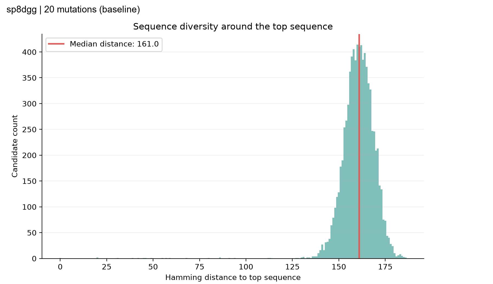

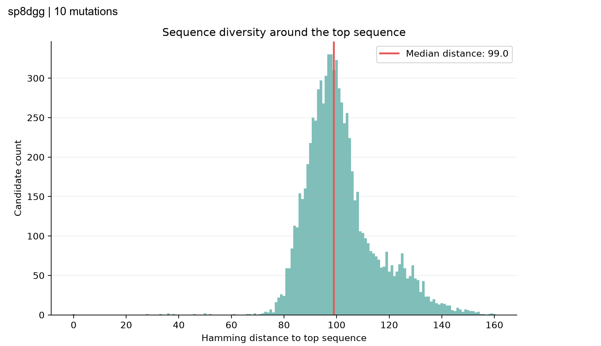

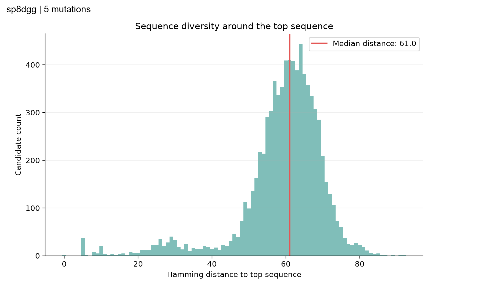

The medians are **161, 99, and 61 bases**, respectively. They measure distances from final-population sequences to the best sequence, rather than distances from independently sampled random sequences.

The results are consistent with smaller mutation steps favouring local exploitation. Establishing faster convergence, or a general effect beyond these runs, would require generation histories and repeated runs.

## 4. Forty mutations produce a lower-scoring endpoint

With 40 mutations, the highest comparison score is 735.79, below the baseline's 1,076.29. The median distance to the top sequence increases to 175 bases.

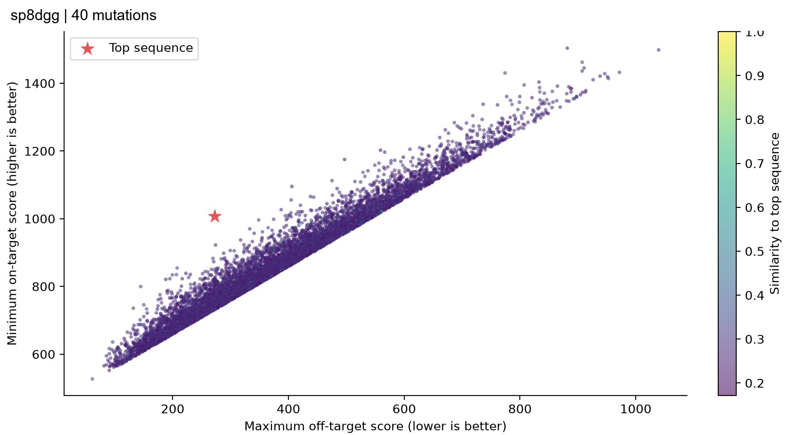

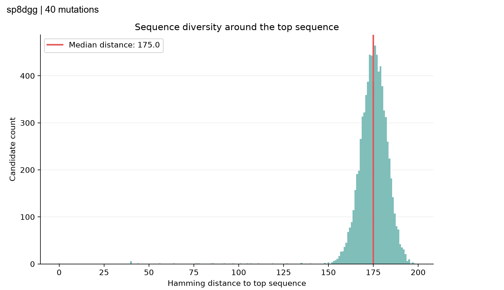

This endpoint is consistent with larger mutation steps making local improvement harder. The final-population plots alone cannot measure how much convergence slowed or how the effective strength of selection changed.

## 5. An off-target power of 1.2 gives approximately sixfold predicted separation

For the highest-comparison-score candidate in Off-target power 1.2, minimum on-target activity is 1,243.38 and maximum off-target activity is 211.41. Their ratio is **5.88**, approximately sixfold. The comparison score is 1,031.97.

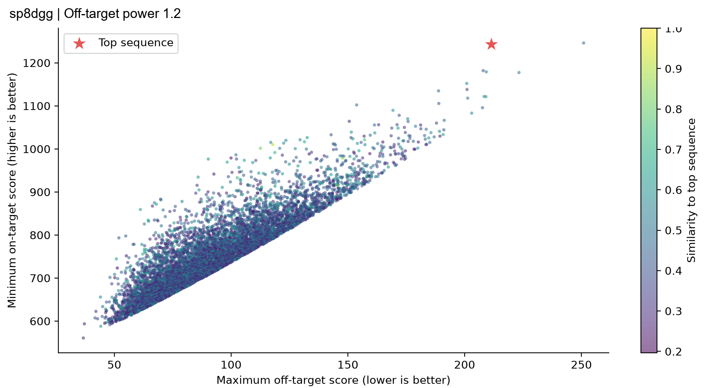

For context, the baseline's corresponding candidate has predictions of 1,548.81 and 472.52: a ratio of 3.28 and a comparison score of 1,076.29. Thus the power-1.2 candidate has better predicted relative separation, while the baseline candidate has a slightly larger absolute difference. These criteria answer different questions.

## 6. Stronger off-target penalties reduce both predicted activities

Among the highest-comparison-score candidates in the power-penalty experiments, increasing the exponent reduces both maximum off-target and minimum on-target predictions:

| Experiment | Minimum on-target | Maximum off-target | Comparison score |
|---|---:|---:|---:|
| Off-target power 1.2 | 1,243.38 | 211.41 | 1,031.97 |
| Off-target power 1.4 | 799.90 | 81.01 | 718.89 |
| Off-target power 1.6 | 302.48 | 33.69 | 268.79 |
| Off-target power 1.8 | 140.67 | 17.29 | 123.38 |

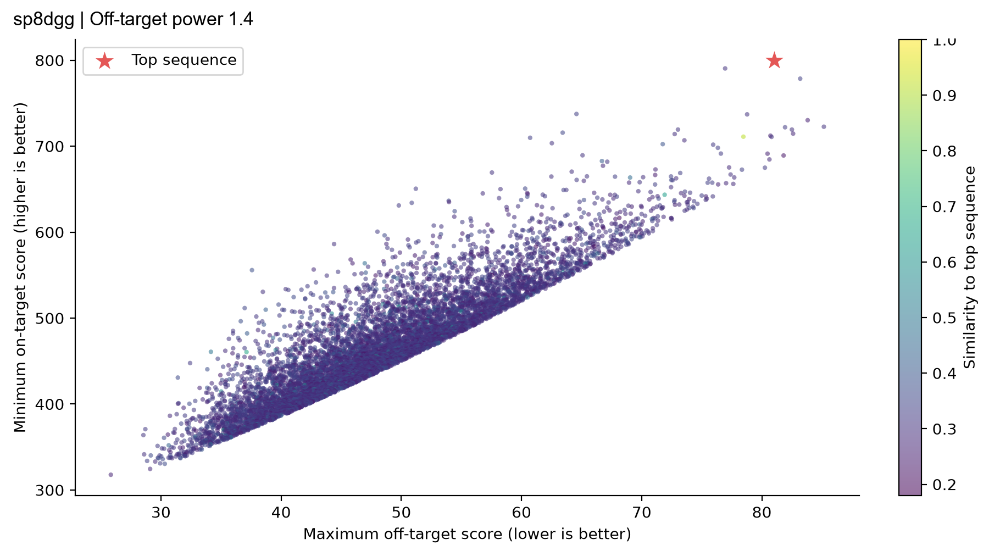

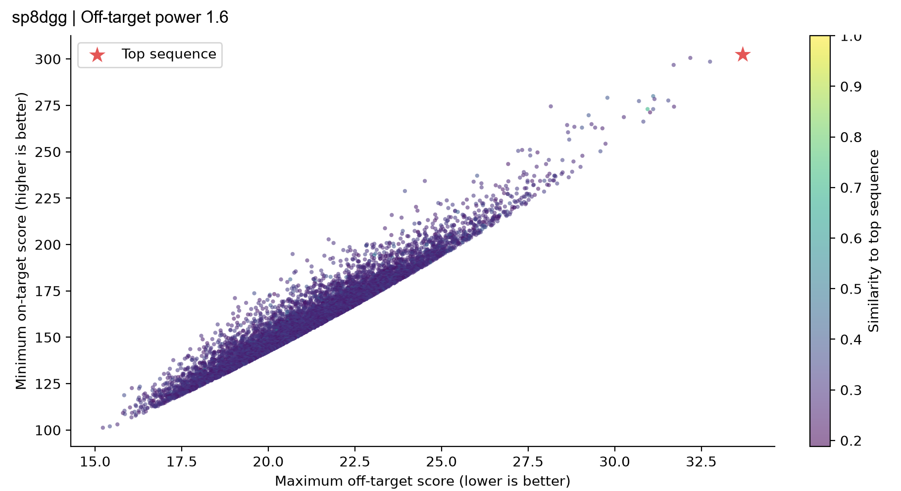

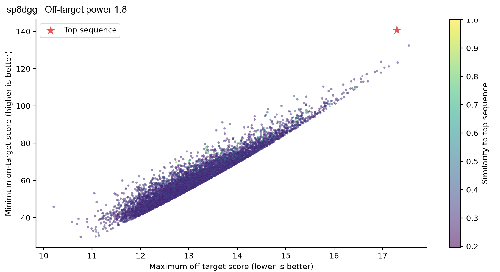

These runs are less useful if retaining high on-target activity is a priority. A nonlinear penalty can generate a curved selection boundary; the plots do not establish a specifically parabolic relationship. Scores and axis ranges differ across plots.

## 7. Selecting 500 sequences while enforcing diversity

The pooled analysis combines the final populations of all 16 sp8dgg experiments. After BsaI filtering, it contains 107,290 candidate rows, compared with 117,000 before filtering: 9,710 rows, or about **8.30%**, were removed.

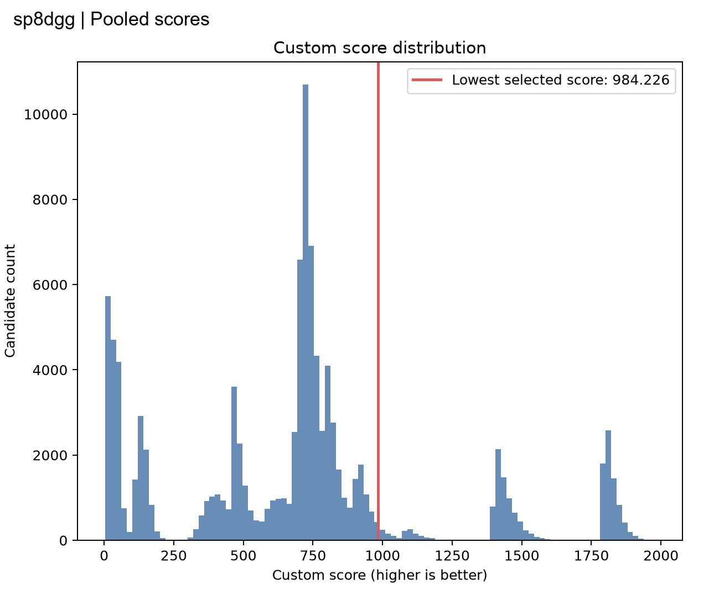

The final selection uses the following procedure:

1. Pool the final populations for sp8dgg across experiments.
2. Remove sequences containing `GGTCTC` or its reverse complement `GAGACC` (the two orientations of the BsaI recognition site).
3. Rank the remaining candidates by the common comparison score, highest first.
4. Greedily accept a candidate only if its Hamming distance from **every already accepted sequence** is at least 100. Stop at 500 accepted sequences.

The distance constraint therefore applies across experiments as well as within each experiment. This differs from filtering each population separately before merging. A candidate is compared with accepted candidates, rather than with every higher-scoring candidate, including those already rejected.

The resulting set contains 500 unique sequences of length 239, with minimum pairwise distance **100** and no occurrence of either excluded motif. The comparison-score range is **984.23–1,978.08**. These properties were independently checked on the selected sequences.

Black circles mark the selected candidates in the pooled on-target/off-target plot:

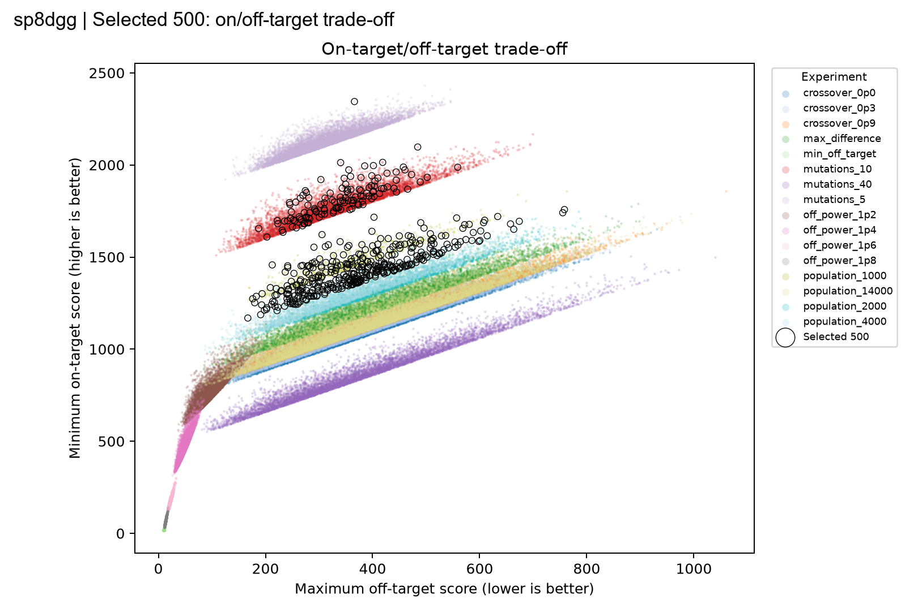

The experiment score distributions show why unconstrained score ranking would heavily favour a few experiments:

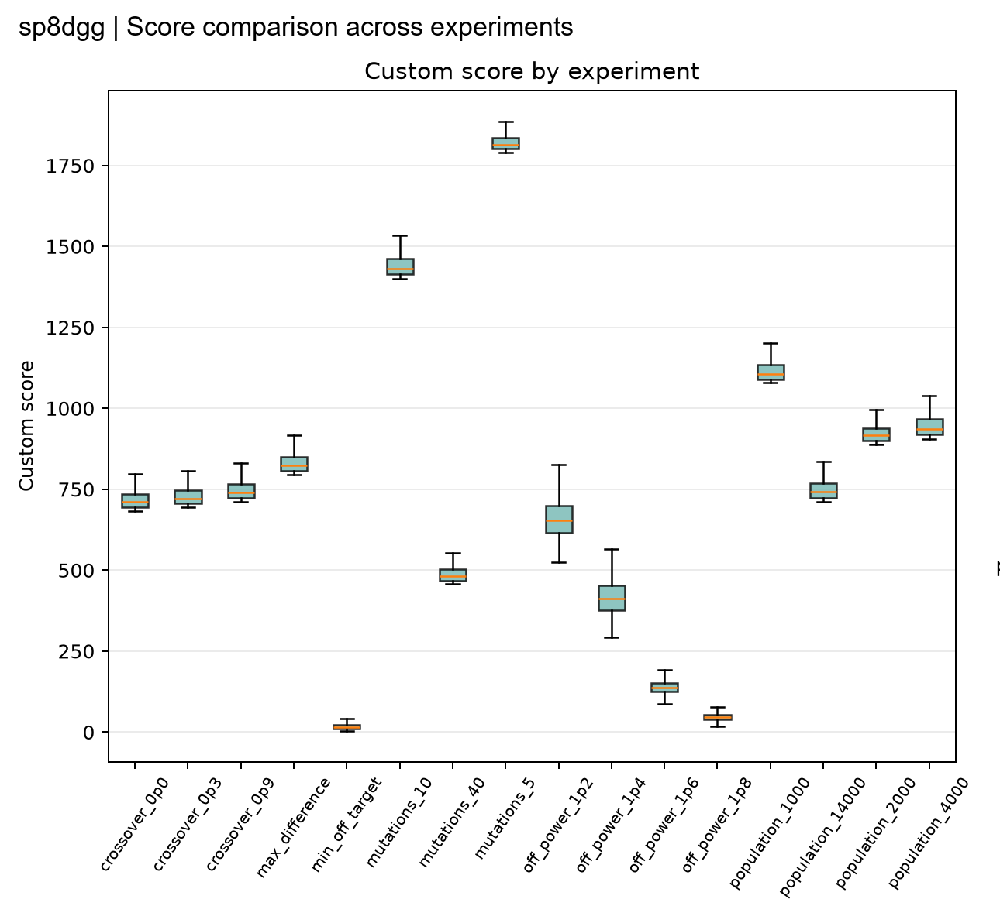

After applying the distance constraint, the selected set draws from nine experiments:

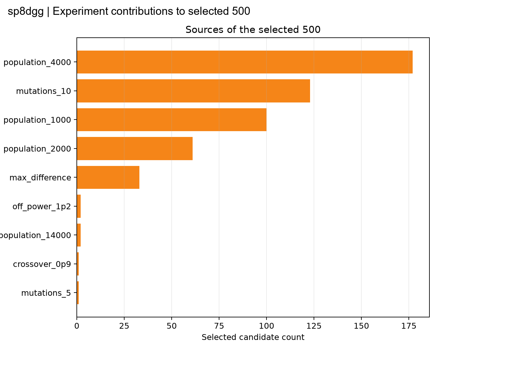

| Experiment | Selected sequences |
|---|---:|
| Population size 4,000 | 177 |
| 10 mutations | 123 |
| Population size 1,000 | 100 |
| Population size 2,000 | 61 |
| 20 mutations (baseline) | 33 |
| Off-target power 1.2 | 2 |
| Population size 14,000 | 2 |
| Crossover probability 0.9 | 1 |
| 5 mutations | 1 |
| **Total** | **500** |

Although 5 mutations has the highest-scoring candidate, it contributes only one sequence under the global distance constraint. High scores alone therefore do not translate into many diverse selected candidates.

## 8. Next experiment: vary the number of mutations

A useful next hypothesis is that sampling the number of mutations, instead of fixing it, could combine small local improvements with occasional larger exploratory steps. The current results motivate this experiment but do not test it. Compare a variable-mutation run against fixed-mutation controls using the same evaluation budget, multiple seeds, comparison scores, and diversity measurements.
